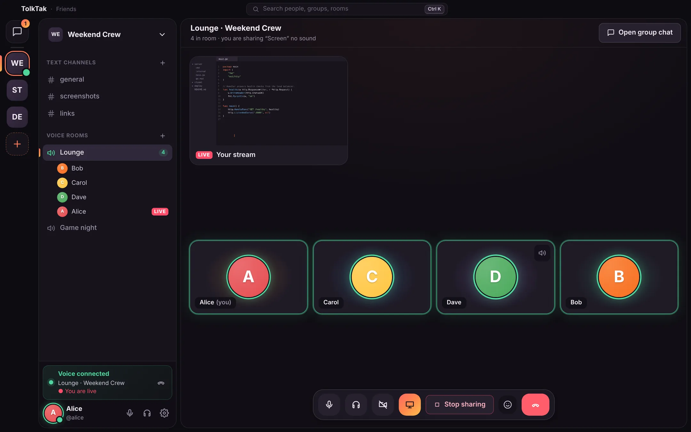

# TolkTak

An open-source communication server.

Direct and group chats, audio and video calls, and configurable screen sharing with sound. For work, games and everyday conversations. All features are available for free.

[Website](https://tolktak.d4enst.ru/en/) · [Downloads](https://tolktak.d4enst.ru/en/download/) · [Documentation](https://tolktak.d4enst.ru/en/docs/) · [Русский](README.ru.md)

The project is in early development.

## Desktop app

[Builds for Windows, macOS and Linux](https://tolktak.d4enst.ru/en/download/) · [Registration and sign-in](docs/install/desktop-app.md#registration-and-sign-in)

## Self-hosting

TolkTak can run on your own hardware or a rented server.

[Requirements](docs/install/requirements.md) · [Install with Docker](docs/install/docker.md) · [Install from source](docs/install/source.md)

## Development

The server uses Python and FastAPI, and the app uses Electron and Preact. LiveKit handles voice, video and screen sharing.

[Architecture](docs/development/architecture.md) · [Building and testing](docs/development/building.md) · [Product website](website/README.md)

See [CONTRIBUTING.md](CONTRIBUTING.md) and the [code of conduct](CODE_OF_CONDUCT.md) for contribution guidelines.

## Security

There is no end-to-end encryption yet. The server operator has access to messages and files. Files can be downloaded by anyone with their link.

[Security model](docs/development/architecture.md#security-model) · [Reporting a vulnerability](SECURITY.md)

## License

[AGPL-3.0-or-later](LICENSE).

Third-party software

TolkTak uses LiveKit (Apache-2.0), Electron and Preact (MIT), FastAPI, Tortoise ORM, SQLite and PostgreSQL. Audio processing uses RNNoise and GTCRN via [web-noise-suppressor](https://github.com/sapphi-red/web-noise-suppressor) (MIT), and [DeepFilterNet](https://github.com/Rikorose/DeepFilterNet) (MIT or Apache-2.0). Electron ships its own third-party notices.

The website uses Golos Text under [SIL OFL 1.1](website/fonts/OFL.txt).

