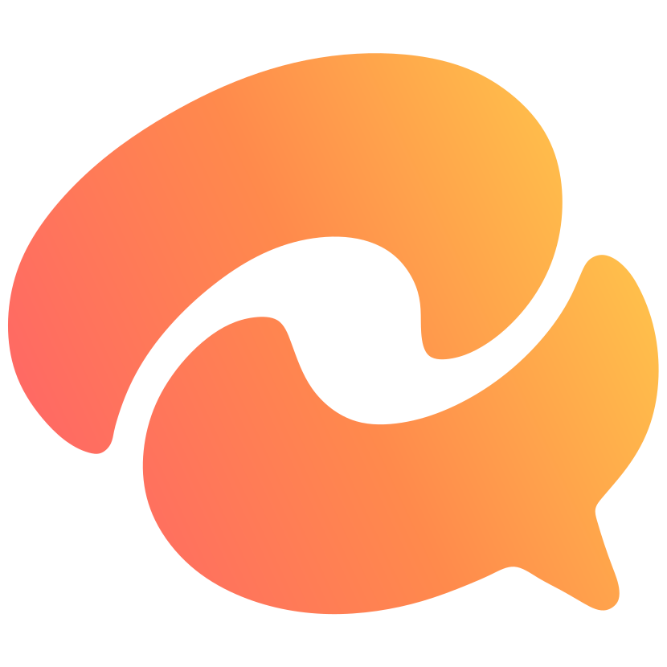

# TolkTak

Сервер для общения с открытым исходным кодом.

Личные и групповые чаты, аудио- и видеозвонки, настраиваемые трансляции со звуком. Для работы, игр и повседневного общения. Все возможности доступны бесплатно.

[Сайт](https://tolktak.d4enst.ru/) · [Загрузки](https://tolktak.d4enst.ru/download/) · [Документация](https://tolktak.d4enst.ru/docs/) · [English](README.md)

[](LICENSE)
[](https://github.com/D4eNst/tolktak/releases)


Проект находится на ранней стадии разработки.

## Приложение

[Сборки для Windows, macOS и Linux](https://tolktak.d4enst.ru/download/) · [Регистрация и вход](docs/ru/install/desktop-app.md#регистрация-и-вход)

## Собственный сервер

TolkTak можно разместить на своём оборудовании или арендованном сервере.

```sh
docker run --network host d4enst/tolktak
```

[Требования](docs/ru/install/requirements.md) · [Установка через Docker](docs/ru/install/docker.md) · [Установка через Docker Compose](docs/ru/install/compose.md) · [Установка из исходников](docs/ru/install/source.md)

## Разработка

Сервер — Python и FastAPI, приложение — Electron и Preact. За голос, видео и трансляции отвечает LiveKit.

[Архитектура](docs/ru/development/architecture.md) · [Сборка и тестирование](docs/ru/development/building.md) · [Сайт проекта](website/README.md)

Правила участия — в [CONTRIBUTING.md](CONTRIBUTING.md) и [кодексе поведения](CODE_OF_CONDUCT.md).

## Безопасность

Сквозного шифрования пока нет. Владелец сервера имеет доступ к переписке и файлам. Файл доступен любому, у кого есть его ссылка.

[Модель безопасности](docs/ru/development/architecture.md) · [Сообщение об уязвимости](SECURITY.md)

## Лицензия

[AGPL-3.0-or-later](LICENSE).

<details>
<summary>Сторонние компоненты</summary>

Используются LiveKit (Apache-2.0), Electron и Preact (MIT), FastAPI, Tortoise ORM, SQLite и PostgreSQL. Шумоподавление — RNNoise и GTCRN через [web-noise-suppressor](https://github.com/sapphi-red/web-noise-suppressor) (MIT), [DeepFilterNet](https://github.com/Rikorose/DeepFilterNet) (MIT или Apache-2.0). Electron включает собственные уведомления о сторонних компонентах.

Шрифт сайта Golos Text — [SIL OFL 1.1](website/fonts/OFL.txt).

</details>
